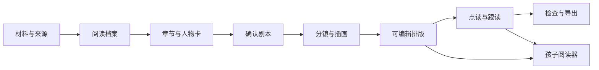

# 产品与验收规格 v1.0

状态：开发要求，未实现。规格面向家庭首版，不预先宣称教育效果或儿童试读结果。

## 产品完成的最小价值

家长能把一段已知来源的故事做成一章可编辑的图文伴读；孩子能翻页、听一句、读一句；家长可以保存、修改和带走作品。第一章做得清楚、可读、可修改，是扩展整本书的前提。

## 用户与使用情境

| 使用者 | 任务 | 设计回应 |
| --- | --- | --- |
| 家长 | 调整英语难度与故事长度 | 已会词表、句型、重点词、字数检查 |
| 家长 | 保留喜欢的画面，只改某一句 | 分离插画与正文，局部修改与撤销 |
| 孩子 | 看懂剧情，点击气泡听声音 | 短对话、格号、逐格阅读、句级高亮 |
| 亲子 | 一人演一个角色 | 角色选择与对应留白 |
| 家长 | 打印、给孩子离线看 | 打印布局、答案分离；离线媒体包后续实现 |

## 端到端流程

任一步可以保存草稿。家长编辑内容不要求先使用在线模型。批量生成的确认以明确服务、章节范围和预算为单位，避免每句重复确认。

## 功能优先级

| 阶段 | 必须完成 | 阶段边界 |
| --- | --- | --- |
| M0 | 原创五页数据、家长/孩子界面、文字编辑、设备语音预览、逐句跟读、保存恢复、JSON/PNG/打印 | 插画可为清楚标识的占位；没有真实配音文件导出 |
| M1 | 文本整理、角色参考、实际图片与 TTS、版本与局部重生成、媒体包、音频字幕、确定版式 PDF | 至少一章真实成品，缺配置就标未完成 |
| M2 | 全书章节管理、跨章继承、录音回放、离线阅读包、完整自然语言修改 | 完成真实离线检查后才称离线 |
| M3 | 可选视频、多语言、教师工作区与朗读反馈 | 需要独立需求与验证；不默认开发 |

TXT、PDF、DOCX、EPUB、图片 OCR 都是可选导入扩展，按实现顺序标状态。扫描 PDF 没提取出文字时不能假装已读到正文，提示 OCR 或粘贴原文。导入流程显示分段结果、页码/段落定位与缺口。

## 页面与关键状态

| 页面 | 成功状态 | 必须处理的其他状态 |
| --- | --- | --- |
| 书架 | 展示项目、继续编辑 | 没有项目；本地存储容量不足 |
| 导入 | 分段预览、来源记录 | 不支持格式、空文字、OCR 不确定、过大文件 |
| 阅读档案 | 家长确认的词表与句型 | 没有词表、课程匹配未验证 |
| 人物页 | 可复用角色卡 revision | 无参考图、相互冲突的服装/颜色 |
| 分镜编辑 | 目标格、气泡、顺序可改 | 文字溢出、图缺失、生成失败 |
| 音频页 | 句子与对应音频版本匹配 | 预览声音不可用、音频 stale、无真实文件 |
| 阅读器 | 指定句子播放、可翻页 | 快速连续点击、暂停、切页、声音被系统阻止 |
| 导出页 | 资源完整、选择版式 | 缺图片/音频、未确认素材、答案意外可见 |

“设备语音可预览”“真实音频已生成”“可导出”是三个独立状态。

## 语言规则

1. 词数按声明的分词规则计算。缩写如 It's 与连字符词算一个 token，标点不单独算词。
2. 核心词卡默认 3-5 个；实际新词是相对家长已会词表的未知词。没有词表时返回 unknown。
3. 全章扫描气泡、旁白、词卡、课文、找物、活动与界面中的教学文字；不能只验证漫画页。
4. 名字、拟声词和特殊剧情词可以单列，但不能从阅读负担统计中消失。
5. 不提供未经核对的音标。课程映射、词元与语法复杂度无法验证时保留说明。
6. 语言超过预算时，先提出短句或图像表达；改变来源事实需要家长能看见差异。

## 视觉规则

人物脸部与体型、服装、主道具保持角色卡约束。来源明确的物件数量不能随生成漂移。气泡尾部指向说话者，当前阅读格有可识别边框，重要词同时使用字重/标记与底色。

建议在 390×844 手机、1024×768 平板、1440×900 桌面尺寸检查；这些是验收目标尺寸，不代表实际设备已测试。屏幕英语正文可从 18-24px 起调，打印正文建议从 14pt 起调，以实际渲染和家庭试读为准。平板整页与手机逐格分别设计，不能只把 A4 页面缩成手机小图。

关闭中文时不能产生巨大空洞或隐藏原来的阅读顺序。键盘操作、焦点、文本替代与减少动效随首版实现。文本层尽量保持真实文字。

## 具体验收场景

| 编号 | 操作 | 应观察到的结果 |
| --- | --- | --- |
| A01 | 无任何密钥启动原创演示 | 可载入并翻完 5 页，功能状态诚实 |
| A02 | 将一句台词改短、保存、刷新 | 页内气泡与课文一致，修改保留 |
| A03 | 导出 JSON 并重新导入 | 角色、顺序、正文、活动仍可编辑 |
| A04 | 连点两句，再切页 | 只存在当前请求的声音，旧任务被取消 |
| A05 | 跟读模式设置 3 秒空档 | 实际等待后下一句；暂停后不自发继续 |
| A06 | 改一个已经配音的词 | 原配音标 stale，不能默默匹配新文本 |
| A07 | 只调整一格表情 | 其他格和音频保留，不全章重新收费生成 |
| A08 | 核心道具改颜色 | 相关图、描述、问题进入复查列表 |
| A09 | 打印儿童版 | 中文可读、无裁切、答案隐藏；家长版可选答案 |
| A10 | 生成或导入真实音频 | 实际媒体可播放，时长真实，字幕对应确认版 |
| A11 | 拒绝麦克风或服务未配置 | 仍可阅读、编辑和保存，无虚假成功 |
| A12 | 检查 bundle、项目包与日志 | 不含 API 密钥，录音不被默认打包外传 |
| A13 | 源资料含命令式文字 | 不执行，不改变工具规则，只留在资料中 |
| A14 | 存储失败或媒体缺失 | 明确提示并可导出当前草稿，无成功假象 |
| A15 | 离线包断网后重新打开（M2） | 字体、图片、真实音频可加载；不依赖临时远程链接 |

A04-A06 涉及状态或依赖，可写必要测试。界面低影响样式不要求额外镜像测试。记录测试方式、浏览器、日期、证据与未验证环境。

## 真实试读记录

完成可读样章后，记录家长观察：孩子是否愿意继续翻页、在哪一格不理解、哪句需要中文、是否愿意跟读、喜欢哪种游戏。读多久不是越多越好；页面点击与音频播放次数不等于理解或学会。先记录少量具体反馈，再修改，不展示虚假学习增益百分比。

## 必须说清楚的交付状态

文档里列出的所有功能目前都是要求。实现时每个功能列 implemented / demo / requiresConfiguration / planned / blocked，附实际证据。不得用静态按钮、预生成 mock 数据或占位波形冒充真实生成服务。
