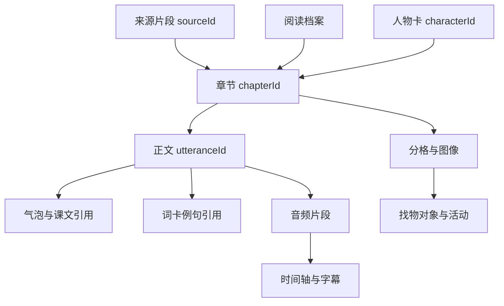

# 数据与音频协议 v1.0

本文件定义未来实现应遵循的关系和运行约束。JSON Schema 约束结构，另需语义检查引用、时间、播放状态与素材范围。当前没有音频生成或播放测试结果。

## 唯一正文与对象关系



内容 ID 稳定，revision 记录变化。文字改版不更换句子 ID，但更新 revision 和 contentHash。复制为新章产生新 ID，并保留 copiedFrom 引用（后续扩展）。同一事实不能靠复制多份文字维持一致。

## 核心实体

| 实体 | 最小责任 |
| --- | --- |
| BookProject | 项目标题、版本、来源、阅读档案、人物、章节和媒体 |
| SourceSegment | 原文/摘要/OCR/原创来源区分，段落位置与文字 |
| ReaderProfile | 已会词、允许句型、词数预算与验证状态 |
| Character | 固定视觉描述、道具、声音描述与 revision |
| Chapter | 来源、故事事件、正文、页面、词汇和活动 |
| Page / Panel | 页面职能、阅读顺序、画面要求、元素区域 |
| Utterance | 唯一正文、中文辅助、说话人、来源和音频关联 |
| VocabularyItem | 重点与新词属性、发音正文、例句 ID |
| Activity | 题目、证据、答案、是否家长可见 |
| MediaAsset | 实际资源状态、类型、位置、来源、hash 与依赖 |
| AudioCue | 真实播放区间、对应句子和时间戳来源 |
| Revision / EditPatch | 修改范围、原版本、影响与撤销 |
| Job | 任务范围、服务、用量、结果和未知收费状态 |

当前 Schema 重点约束可交换内容。Revision、Job、EditPatch 是运行时契约，实际开发需补相应 Schema 与验证。不能把内容 Schema 已存在说成全部运行逻辑已实现。

## 来源与授权记录

`rights.status` 建议枚举 original、licensed、publicDomainVerified、unknown。原始书籍来源与生成素材来源分别保存。`privateStudy` 不是自动取得公开传播权；`publicDistributionAllowed` 必须有明确来源依据，未知时保持 false。

来源类型用 original、providedText、providedSummary、ocr、existingAdaptation。原书中有的事实用 sourceRefs 指向证据；新增桥段用 originalAddition 或 teachingRewrite。来源不足的内容标 unverified。保持可保存草稿，不把“有文件”转成“原书已核验”。

## 坐标与页数

bounds 使用 x/y/w/h，范围 0-1。panel 的坐标相对页面，bubble 相对对应分格，找物热点相对实际插画有效区域。需同时检查 x+w≤1、y+h≤1。

逻辑页与物理页不同。五页模板的第 2 页是 panorama；采用 doubleSpread 模板时可能占两个物理页，物理页数在导出清单中计算，不能改写逻辑内容数量。

热点在分镜阶段标 proposed，真实图上校准并人工检查后才标 verified。没有图片时不能声称“找物目标已存在”。

## 适配器接口（实现要求）

```ts
interface TextProvider {
  draftChapter(request: DraftRequest, signal: AbortSignal): Promise<ChapterDraft>;
}
interface ImageProvider {
  createPanel(request: PanelArtRequest, signal: AbortSignal): Promise<ImageResult>;
}
interface SpeechProvider {
  capabilities(): SpeechCapabilities;
  synthesize(request: UtteranceRequest, signal: AbortSignal): Promise<SpeechResult>;
}
```

SpeechCapabilities 包括真实媒体输出、句/词时间戳、支持语言和可选声线。SpeechResult 返回实际资源、时长、媒体格式、时间戳来源与用量；设备语音仅提供 preview 接口，不假冒 synthesize 返回 MP3。

建议本地服务路由：POST /api/text/chapter-draft、POST /api/images/panel、POST /api/speech/utterance、GET /api/jobs/:id、POST /api/jobs/:id/cancel、POST /api/exports/book。所有 ID、范围和载荷需验证。请求只包含当前选定片段与必要的角色卡，不随手发送整本书。

## 音频制作与同步

1. 确认正文、语言、角色声线和发音表。
2. 一次生成或导入一句真实音频。测量媒体时长，不用字数猜时长后冒充实际值。
3. 保存到 MediaAsset，绑定 utteranceId/revision/textHash 与声音配置 hash。
4. 故事模式使用章节 `audioOrder`；单词模式使用对应 pronunciationUtteranceId。
5. 跟读模式在每句后等待选定 pauseMs；扮演模式只跳过孩子所选角色的标准音，并保留可见台词和等待。
6. 整章故事版和跟读版是两个 composition。跟读版静音是其实际媒体的一部分，要生成独立时间轴。
7. VTT/SRT 从实际 composition 的 cue 生成；有提供者词级时间戳时验证后采用，没有时仅做句级。

AudioCue 最小字段：utteranceId、startMs、endMs、alignmentSource、textRevision。要求 0≤startMs<endMs≤真实合成总时长。句子不重叠，静音段没有朗读正文。背景声不影响句子 ID；声音效果默认可关闭。

`audio.currentTime` 是媒体时间轴，调整 playbackRate 时高亮继续使用该轴，不再乘一次速率。设备语音用开始/结束事件做句级高亮；不可靠的词边界事件不能变成稳定的时间戳导出。

只导入浏览器 MediaRecorder 生成的实际格式，检查 MIME，不给 WebM 强行加 mp3 后缀。需要 MP3 时由真正的编码流程生成并验证。

## 播放状态机

idle → preparing → playing → waiting → playing → ended。
playing / waiting 均可进入 paused 或 stopped；任何状态均可能进入 error。

开始新句、切页、退出阅读器、切换模式时：停止当前媒体或设备语音、清理计时器、取消未完成请求、递增 playbackSessionId。旧请求返回时，检查 sessionId 再应用，避免“已翻页却播放旧句”。

暂停 waiting 时保存剩余等待时间；恢复后继续剩余时间，不额外重读或跳过。单句重听只处理本句，不启动全章排队。录音时标准音已结束，避免麦克风把标准音同时录进去；录音结束立即释放音轨。

## 局部变更与失效规则

| 改动 | 重新检查/生成 | 可保留 |
| --- | --- | --- |
| 正文、语言、发音 | 该句音频、其合成音频/字幕、页面布局 | 无关图与音频 |
| 语音配置 | 对应音频、合成与字幕 | 文本和插画 |
| 跟读空档 | 跟读合成、跟读字幕 | 原句音频、故事版 |
| 分格表情 | 对应插画、页面预览 | 原正文和音频 |
| 道具颜色/数量 | 相关插画、描述、找物、题目答案 | 未受影响内容 |
| 人物服装等固定特征 | 用到相应角色 revision 的插画 | 无关人物插画 |
| 正文顺序 | 组合音频、字幕、显示顺序 | 逐句媒体 |

缓存 key 至少包含正文 hash、语言、声线、发音配置、提供者和模型版本。资产按生成时依赖保存；当前依赖不同则 stale，导出不悄悄使用旧资产。

## 修改与任务运行

EditPatch：baseRevision、targetIds、operations、affectedAssetIds、warnings。应用前核对原版本和对象合法性，应用后产生新版本。撤销恢复旧内容，但媒体仍需按实际依赖判有效，不能单纯将所有 stale 改回 ready。

Job：id、kind、scope、provider、status、attempt、requestHash、providerRequestId、estimatedUsage、actualUsage、error。状态含 queued、running、succeeded、failed、cancelled、stale、outcomeUnknown。取消浏览器等待不等于提供者已经停止计费。未知结果先查询或人工检查；服务不提供查询时标未知，不自动重复收费请求。对可安全重试的请求最多建议 2 次，尊重服务限流。

## 导出包（未来）

内容：版本化 manifest JSON、章节 JSON、真实图片、真实音频、字幕、所需字体及许可说明、校验清单。依赖资源使用包内相对位置，不含临时 object URL。

默认不含原书全文、服务密钥、儿童录音、家长答案。家长版答案是显式导出选项；录音仅单独显式导出，不被公共阅读包默认继承。打印包与公开分发包分别检查来源范围。

所有自主命名文件以主体名称、版本、扩展名命名，如 `红帽子绘本v1.0.pdf`、`红帽子故事音频v1.0.mp3`、`红帽子跟读字幕v1.0.vtt`。分句媒体可使用 `第1句跟读音频v1.0.mp3`，不使用下划线。
